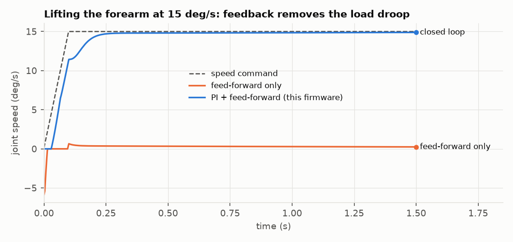
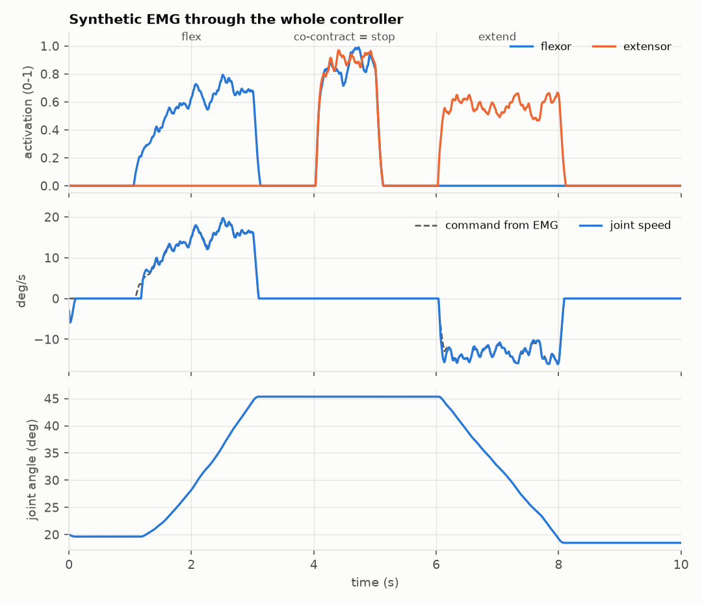
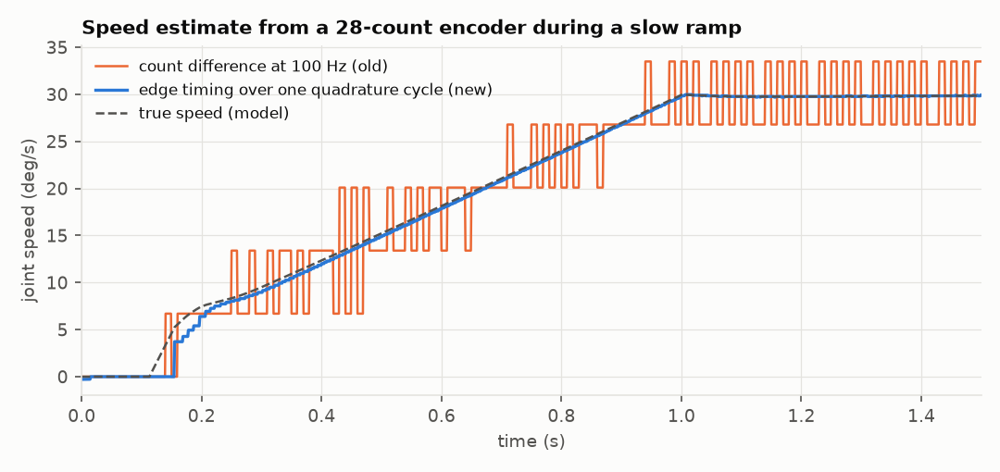

# Orthosis control firmware

This is the firmware for the EMG-driven arm orthosis: an ESP32-S3 on the v2 board, driving a goBILDA Yellow Jacket 5.2:1 gearmotor through a BTS7960.

Two muscles control the joint. The flexor drives it up, the extensor drives it down, and contracting both stops it. A PI velocity loop on the motor encoder makes the joint move at the speed you ask for, whatever the limb weighs, and holds it where it stops.

**Latency.** Real forearm EMG was run through the whole controller and a simulated arm. The joint starts moving **43 ms** after the muscle does, reaches half its commanded speed at **67 ms**, and stops **32 ms** after the muscle relaxes. That's 24 real contractions; see [Latency](#latency). Before the latency work (the closed-loop rewrite, still with a two-pole 4 Hz envelope and conservative tuning), it took 103, 139 and 89 ms.

Every decision the firmware makes lives in [`emg_orthosis/orthosis_core.h`](emg_orthosis/orthosis_core.h), which has no hardware dependencies. That same file is compiled into [a simulator](sim/) of the motor, gearbox, ball screw, cable, pulley and forearm. The tests run the real controller against that model.

**Status:** designed and verified in simulation. It has not run on the board yet: the v2 PCB isn't fabricated. The numbers below are simulation results, and the bring-up procedure at the end is how they become hardware results.

```
make test       # 26 unit, closed-loop and real-EMG latency tests (host C++, GoogleTest)
make latency    # latency sweep, robustness, ablation and sensitivity checks, with real EMG (~1 min):
                #   results/latency_sweep.txt
make results    # traces, results/metrics.json, the figures below
```

CI ([`.github/workflows/firmware.yml`](../.github/workflows/firmware.yml)) runs the tests. It also compiles the sketch with the real Arduino-ESP32 3.x toolchain for the ESP32-S3.

## What changed from the first version, and why

| | Before | Now | Why |
|---|---|---|---|
| **Motor command** | EMG set PWM duty directly (open loop) | EMG sets a joint **speed**. A PI loop on the encoder drives the joint to it, with plant-inversion feed-forward. | Duty equals speed only with no load. Lifting a forearm at 15 °/s, feed-forward alone stalls (98% speed error), while the loop holds the error to 0.8%. |
| **Holding still** | Dynamic brake, which slows sag but can't stop it | The loop holds position at zero command | The integral of a speed error is a position error, so the PI is a position hold. Drift over 5 s against the limb in simulation: 0.000°. |
| **Speed measurement** | Encoder counts per 10 ms tick | Timing between encoder edges, over one full quadrature cycle | At 25 °/s the motor produces only 0.37 counts per ms. Counting per tick gives 12–111% error at arm speeds; edge timing gives under 0.02%. |
| **Speed limit** | Proportional back-off on duty ("governor") | The speed setpoint is capped, then acceleration-limited | The loop now tracks the setpoint, so capping it is the speed limit. |
| **Soft limits** | Stop commanding at the limit | A braking curve, v ≤ √(2·a·d) | The joint decelerates into the limit instead of arriving at speed: full speed into 30° stops at 29.47°. |
| **Envelope** | Two poles at 3 Hz, commented as "~55 ms" (really 106 ms) | A Bayesian amplitude estimator (Sanger 2007), with a 20 ms onset confirm | On 200 real contractions, even against the faster 4 Hz version of the two-pole filter, it halved the time to half command (97 → 48 ms) and cut the p90 stop lag from 73 to 13 ms, with slightly less jitter. See [Latency](#latency). |
| **Encoder sign** | Unchecked | A runaway detector, plus `j` (identify) reports the sign | A reversed encoder turns a velocity loop into positive feedback. The detector catches it in 211 ms after 2.3° of travel. |
| **Tuning** | One setting | Conservative until `j` has measured the motor; then a fast tier (500 °/s² ramp, λ 30 ms) | Fast response leans on the feed-forward, which is only as good as the motor model. With datasheet guesses, the fast tier overshoots up to 38% across 36 perturbed motors. Once each motor is identified, the worst case is 20%. |
| **Watchdog** | A software check inside the same loop | The ESP-IDF hardware task watchdog, 200 ms, resets the chip | A reset releases every pin, and the board's pull-downs turn the driver off. A check in the loop it watches can't fire if that loop hangs. |
| **MOT_OK** | Read, only ever printed | Required to arm, and a fault if it drops | |
| **EMG lead-off / artefact** | Unchecked | A railed channel for 20 ms, or an envelope above 2× max contraction (MVC), is a fault | A detached electrode rails the in-amp, which the old code would have read as a full-speed command. |
| **Timing** | `loop()` with `micros()` polling, printing in the same loop | A 1 kHz FreeRTOS task pinned to core 1 (`xTaskDelayUntil`). Serial runs in a separate task. | Printing can never delay the control loop. Worst-case loop time and overruns are reported by `?`. |
| **Encoder ISR** | `digitalRead` plus a lookup table | Direct GPIO register reads, and a table-free Gray-code decode | Both are safe in an IRAM interrupt handler. |

## Control design

```
EMG x4 ──► DC track ─► Bayesian amplitude estimate ─► activation (rest/MVC calibration, 20 ms confirm, hysteresis)
                                                              │
                        flexor − extensor, dead zone, co-contraction = stop
                                                              ▼
                                     speed command (≤ 25 °/s)
                                                              ▼
          accel limit (150 °/s², 500 once identified) ─► braking curve into the soft limits ─► ω_ref
                                                              ▼
       duty = (ω_ref + τ·dω_ref/dt)/K + d_f·sign(ω_ref)  +  Kp·e + Ki·∫e      e = ω_ref − ω
                                  feed-forward                    PI (anti-windup)
                                                              ▼
                           BTS7960 ─► motor ─► 5.2:1 ─► belt (1:1) ─► 4 mm screw ─► cable ─► 47 mm pulley ─► joint
                             ▲                                                                                 │
                             └──── ω from encoder edge timing (28 counts/rev at the motor) ◄────────────────────┘
```

**Plant model.** A DC motor behind a stiff transmission is first order from duty to speed: ω/d = K/(τs + 1).
- **Gain:** K ≈ 187 °/s per unit duty at the joint: the datasheet's 1150 RPM no-load speed at 12 V, carried through the screw and pulley. The same datasheet (12 V, 1150 RPM, 9.2 A stall, 0.25 A no-load) gives R = 1.30 Ω and Ke = 0.0186 V·s/rad. 12 V/Ke alone would give 193 °/s; the no-load friction takes the difference.
- **Time constant:** τ = J·R/(Kt·Ke) ≈ 20 ms, with the forearm's inertia reflected through the 192:1 overall ratio (5.2 × 1:1 belt × 2π·23.5 mm / 4 mm).
- **Measure both on your hardware:** `j` identifies K, friction and τ on the real motor.

**Feed-forward** inverts that model. The ω_ref/K term supplies the back-EMF voltage, and the τ·dω_ref/dt term supplies the torque to accelerate the inertia. With the model right, the joint follows the shaped setpoint with no lag. The PI then only has to reject what the model misses: limb weight, friction error and supply sag. Before the ramp anti-windup below existed, adding the acceleration term cut the nominal step's overshoot from 14% to 9%. With the anti-windup in place, nominal overshoot is under 5% either way, and the term mostly changes robustness: it lowers the conservative tier's worst case across the 36 perturbed motors (19% → 16%) but raises the fast tier's (7% → 20%). That trade is worth re-checking on the bench (`make latency`, part 3).

**PI gains** use IMC tuning:
- Cancel the plant pole (Ti = τ) and place the closed loop at λ: 50 ms by default, 30 ms once the motor is identified.
- That gives Kp = τ/(K·λ) and Ki = 1/(K·λ).
- Ki doubles as the holding stiffness: each degree of sag adds Ki of duty (0.11 conservative, 0.17 fast). Pushing the held forearm down with 4 N·m sags it 0.74° (conservative) or 0.51° (fast). At 2 N·m, friction in the screw and gearbox holds the conservative tier without any sag (`make latency`, part 4).
- **Anti-windup, part 1:** the integrator stops accumulating while the output is saturated and the error would push it further.
- **Anti-windup, part 2:** while the setpoint is ramping at the acceleration limit, the integrator may pull back a joint that is ahead of the setpoint, but may not charge on the lag. Tracking a ramp is the feed-forward's job. Without this, the ramp's lag charges the integrator and comes back out as overshoot: 9% (conservative) and 18% (fast) on the nominal 0 → 20 °/s step, 21% and 34% at worst across the 36 perturbed motors. With it: none and 4.5% nominal, 16% and 20% worst (`make latency`, part 3).

**Bayesian envelope.** The EMG's amplitude is treated as a hidden state. The estimator keeps a probability over 64 log-spaced amplitude levels and updates it every sample:
- **Predict:** the amplitude can drift slowly between neighbouring levels, or jump anywhere with a tiny probability.
- **Update:** multiply by the likelihood of this sample. The likelihood is Laplacian, because EMG is heavier-tailed than Gaussian.
- **Output:** the posterior mean of log-amplitude.

Because a jump is always possible, it moves within a few samples when a contraction starts, yet averages hard while the contraction is steady. The catch is that a single electrode pop is also a "jump". So an onset has to hold for 20 ms before it counts, and that takes false starts from 62 a minute to zero, at one artefact per second.

## Simulation results

These come from `make test` and `make results`, with the nominal plant unless stated otherwise.



| Test | Result |
|---|---|
| Speed step 0 → 20 °/s with the forearm (conservative tier) | 146 ms rise (the 150 °/s² ramp), no overshoot, 0.21 °/s steady-state error |
| Lift / lower at ±15 °/s, feed-forward only | 98% / 56% speed error |
| Lift / lower at ±15 °/s, closed loop | 0.8% / 0.3% |
| Hold at zero command against gravity, 5 s | 0.000° drift |
| 2 N·m push on the forearm while moving at 10 °/s | Dips to 0 °/s, recovers to within 0.04 °/s |
| 36 plant variants: inertia ×0.3–3, 10.5–13.5 V, friction ×0.5–2, limb ×0.5–1.5 | Conservative tier: worst overshoot 16%. Fast tier after `j` identifies each motor: worst 20%. All stable, steady-state error < 0.5 °/s. |
| Full speed into the 30° soft limit | Stops at 29.47° (target 29.5°) |
| Obstruction inside the range | Stall fault 443 ms after contact, motor released |
| Encoder wired backwards | Runaway fault after 211 ms and 2.3° of travel |
| Kill switch opened / MOT_OK dropped / electrode lead off | Coasts that tick / fault that tick / fault within 20 ms |
| Arming without calibration, zero, closed kill switch or MOT_OK | Refused, with the reason |
| Identify (`j`) on the model | K 192 (true 193) °/s/duty; τ 28 ms (true 22; stiction delays the rise); reversed encoder reported |
| EMG end to end (below) | Flex +28.8°, co-contraction 0.00°, extend −31.2°, relaxed hold within 1° |





## Latency

Latency here means how long after the muscle the joint responds. It was measured on 24 real forearm contractions. Each one was:
- recorded in the LibEMG MultiDay set;
- run through the v2 board model at 1 kHz;
- then fed to the full controller after the bench procedure (calibrate, zero, arm, `j`), with the forearm's weight on a simulated joint.

Each contraction ramps up over 50 ms. Resting tone and board noise fill the gaps. The test `Latency.RealEmgOnsetToMotion` pins these numbers in CI.

| | Joint starts moving | Joint at half speed | Joint stops after the muscle does | Speed jitter |
|---|---|---|---|---|
| Before (closed loop, 2-pole 4 Hz, 150 °/s², λ 50 ms) | 103 ms (p90 170) | 139 ms (p90 211) | 89 ms (p90 116) | 2.43 °/s |
| **Now** (Bayesian, 20 ms confirm, fast tier) | **43 ms** (p90 82) | **67 ms** (p90 186) | **32 ms** (p90 36) | **0.99 °/s** |

**Where the 43 ms goes:**

| Contribution | Time |
|---|---|
| The muscle's own ramp to a detectable level | ~16.5 ms |
| The 20 ms onset confirm | 20 ms |
| The motor spinning up (τ ≈ 20 ms) until the joint passes 2 °/s | ~7 ms |
| Sampling and compute | ≤ 1 ms tick, inside the above |

These are medians over the 24 contractions (`make latency`, part 1), so they add up only roughly.

The confirm is the one deliberate cost: it's what keeps artefacts from moving the arm. So **about 40–45 ms is the floor on this hardware**. Going lower means shorter confirm windows and accepting false starts. `make latency` sweeps the ramp and loop time constant (part 1) and checks each setting's robustness (part 2):
- **Going faster buys little.** Against the shipped 500 °/s² and λ 30 ms (43 ms), λ 20 ms starts the joint at 41 ms and 1000 °/s² at 39 ms.
- **It costs robustness.** Across the 36 perturbed motors, the worst step overshoot rises from 20% to 27% (λ 20 ms) or 34% (1000 °/s²).

**How exact are 103 and 43 ms?** They are for the nominal plant. Small plant changes (`make latency`, part 5: gearbox 5.18:1 instead of 5.2, pulley +0.5%, rotor inertia +5%, 12.1 V) move "before" between 102 and 109 ms and "now" between 43 and 45 ms. The cause is friction. While the joint holds still, the integrator settles somewhere inside the stiction band, and that sets how much more duty the breakaway needs. The p90 of "now" depends on one or two slow-starting contractions, so it moves more: 82 to 126 ms. The ~60 ms improvement holds in every case.

How the envelope was chosen: [`analysis/latency_study.py`](analysis/latency_study.py) compares designs on 200 real contractions for onset latency, stop lag, jitter and false starts with motion artefacts. Its results are in [`results/latency_study.json`](results/latency_study.json).

**What the model leaves out.**
- Current isn't modelled dynamically: the motor's L/R is under 1 ms, well below the 1 ms tick.
- The transmission is rigid in both directions. On the built arm ([photo](../orthosis_built.jpg)), a printed toothed belt drives the ball screw and a closed steel-cable loop around the elbow pulley drives both flexion and extension. The model is right only while the belt doesn't skip and the loop is tensioned. Slack is backlash: the motor turns and the joint doesn't.
- The belt is taken as 1:1 (`belt_ratio`); both pulleys look the same size in the photos, but nobody has counted the teeth.
- The only position sensor is the encoder on the motor shaft. Belt skip, cable stretch or any other slip between the motor and the elbow would move the real joint away from what the firmware believes, and nothing would detect it. Zero (`z`) every session.
- The ESP32 ADC is treated as linear, and the synthetic EMG is Gaussian noise with a controlled amplitude.
- The limb and rotor inertia are estimates, which is why the robustness sweep exists. Real numbers come from the bench.

## Bring-up, in this order

**Setup**
1. Arduino IDE: **esp32 by Espressif, 3.x**. Board: ESP32S3 Dev Module. Tools → **USB CDC On Boot: Enabled**.
2. Wire J4 pin 8 (MOT_OK) to something meaningful. At minimum, tie it to MOT_5V through the harness so it means "motor side powered". The firmware won't arm while it reads LOW.

**Motor only: no limb, joint free**
3. Power the motor supply with the kill switch open. `?` should show `kill=OPEN` and `driver=ok`.
4. `m`, then turn the gearbox output 10 revolutions by hand, then `?`. Counts / 28 / 10 is the gear ratio. goBILDA's exact ratio is 1 + 46/11 = 5.18, so expect about 1451 counts. Set `gear_ratio` if it's far from that.
5. Check the whole chain. With the belt and cable on and the limb out, `m`, move the elbow through a protractor-measured 90°, then `?`. It prints the angle the firmware thinks it moved. With a 1:1 belt and a 47 mm pulley, 90° is about 1344 counts; with a 65 mm pulley, about 1858. If the printed angle is off, count the belt teeth and measure the pulley where the cable sits, then set `belt_ratio` and `pulley_dia_mm`.
6. Hand-move the joint to its lower limit and press `z`. Then move it to mid-range, close the kill switch, and press `j`.
   - It reports the encoder sign, K, friction and τ, and unlocks the fast tier for the session.
   - Paste the printed line into `makeConfig()` to keep it. If the sign is reversed, set `encoder_sign = -1` and run `j` again.

**Loop, still with no limb**
7. `c` to calibrate, then `a` to arm. Contract gently and watch `s` telemetry: `ref` and `vel` should agree.
8. Open the kill switch while it's moving: it must coast immediately.
9. `?` shows the worst-case loop time. It should be well under 1000 µs.

**With the limb** — only after everything above passes
10. Keep `joint_max_deg` at 30. Widen the range 10° at a time.

## Files

```
emg_orthosis/emg_orthosis.ino    hardware layer: pins, ADC, PWM, encoder ISR, 1 kHz task, watchdog, serial
emg_orthosis/orthosis_core.h     everything that decides what the motor does (portable C++17)
emg_orthosis/telemetry.h         snapshot the control task publishes for the serial task
sim/plant.h                      motor + transmission + forearm + imperfect encoder
sim/harness.h                    runs the real Controller against the plant at 1 kHz
sim/test_core.cpp                unit tests: decoder, estimator, envelope, activation, shaper, PI
sim/test_closed_loop.cpp         closed-loop, robustness (both tiers), safety and end-to-end tests
sim/latency.h, test_latency.cpp  real-EMG end-to-end latency; sim/data/real_contractions.bin (24 contractions)
sim/latency_sweep.cpp            `make latency`: ramp x loop sweep, robustness, ablation, hold, sensitivity
analysis/                        envelope study on 1,150 real contractions (needs orthosis-emg-decoder's data)
sim/demo.cpp, sim/plot.py        results/metrics.json, traces and figures
sim/arduino_stub/, sketch_check  compiles the .ino as C++ on a laptop
```
